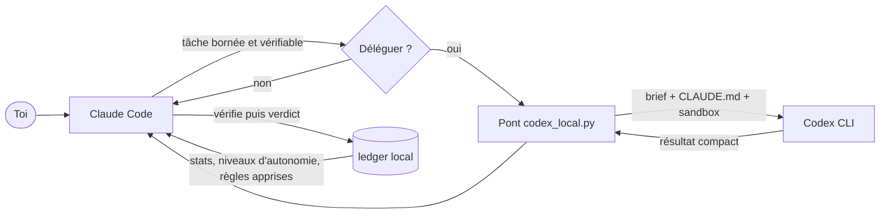

# codex-local

**Deux agents de code valent mieux qu'un. Claude Code délègue à Codex CLI, le fait contredire sur les décisions importantes, et apprend au fil des runs ce qu'il peut lui confier.**

[](plugins/codex-local/.claude-plugin/plugin.json)
[](LICENSE)
[](https://docs.claude.com/en/docs/claude-code/plugins)
[](plugins/codex-local/scripts/codex_local.py)
[](plugins/codex-local/scripts/codex_local.py)

---

## Pourquoi

Si tu as un abonnement Claude et un abonnement ChatGPT, tu paies deux quotas d'agent de code. En pratique, tu en utilises un seul et l'autre reste inutilisé.

`codex-local` les fait travailler ensemble, depuis Claude Code, sans changer tes habitudes :

- **Tu économises ton quota Claude.** Les tâches longues et mécaniques (exploration d'un gros code, tests, refactors répétitifs, résumés de logs) partent chez Codex. Claude garde le raisonnement et la vérification.
- **Tu fiabilises les décisions à risque.** Avant de te présenter une conclusion sur la sécurité, le RGPD, une migration de données, une config prod ou un calcul de paie, Claude la fait attaquer par un autre modèle. Deux modèles différents se trompent rarement de la même façon.
- **La confiance se mérite, elle ne se suppose pas.** Chaque run reçoit un verdict (accepté, modifié, rejeté). Codex gagne de l'autonomie par type de tâche uniquement quand les chiffres le justifient, et la perd au premier rejet.
- **Ton quota Codex est protégé aussi.** Le pont lit le pourcentage restant (fenêtre 5h et semaine) et refuse les délégations ordinaires quand il devient bas, en gardant une réserve pour les secondes opinions.

Une fois installé, il n'y a rien à apprendre : Claude sait quand déléguer et quand demander un avis contradictoire.

## Comment ça marche



1. **Claude décide** s'il délègue, à partir d'une grille claire : ce qui est bien borné, vérifiable à bas coût et gourmand en tokens part chez Codex. Ce qui engage l'architecture, dépend du contexte de la conversation ou touche des secrets reste chez Claude.
2. **Le pont prépare le run** : brief structuré, choix du modèle (`fast`, `standard`, `deep`), sandbox, contrôle du quota, détection de secrets dans le brief.
3. **Codex travaille** avec la même base de connaissances que Claude (`CLAUDE.md`, règles, skills, agents du projet).
4. **Claude vérifie** et enregistre un verdict. Il ne relaie jamais un résultat de Codex sans l'avoir vérifié.
5. **Le système apprend** : `stats` calcule les taux de réussite par type de tâche, recommande les niveaux d'autonomie et mesure si les objections de Codex étaient fondées.

## Installation

Prérequis : [Codex CLI](https://github.com/openai/codex) installé et authentifié (`codex login`), Python 3.8+.

Dans Claude Code :

```
/plugin marketplace add zezel/Claude-skill-codex-local
/plugin install codex-local@local-tools
```

C'est tout. Le hook et les skills sont actifs dès l'installation, et chaque projet s'initialise au premier run. `/codex-local doctor` sert uniquement au diagnostic.

Pour tester sans installer, depuis un clone du dépôt :

```bash
claude --plugin-dir ./plugins/codex-local
```

## Ce que contient le plugin

| Élément | Rôle |
|---|---|
| Hook `SessionStart` | expose `"$CODEX_LOCAL"`, l'état de Codex et les runs sans verdict au début de chaque session |
| Skill `codex-delegation` | quoi déléguer, dans quel mode, avec quel modèle, comment briefer et vérifier, discipline de quota |
| Skill `codex-second-opinion` | protocole de contradiction (avis à l'aveugle, puis attaque), obligatoire sur les enjeux élevés |
| Skill `codex-learning` | verdicts, promotion et rétrogradation d'autonomie, règles apprises |
| Commande `/codex-local` | `doctor`, `status`, `quota`, `budget`, `config`, `delegate`, `review`, `stats`, `learn` |
| `scripts/codex_local.py` | le pont : `run`, `record`, `stats`, `pending`, `quota`, `budget`, `config`, `doctor` |

Les skills se déclenchent seuls selon le contexte. La commande sert à forcer une action ou à consulter l'état.

## La seconde opinion contradictoire

C'est la fonction la plus utile du plugin. Elle est obligatoire avant toute conclusion définitive sur :

- sécurité, authentification, permissions, exposition de données
- données personnelles, RGPD, conformité
- suppression, migration ou fusion de données, opérations irréversibles
- configuration de production, déploiement, DNS, accès
- calcul financier, paie, facturation
- analyse juridique ou contractuelle
- diagnostic d'incident qui déclenche une action coûteuse
- choix d'architecture difficile à défaire

Le protocole évite les deux pièges classiques, l'ancrage et la complaisance :

1. **À l'aveugle d'abord** (`--mode blind`) : Codex reçoit la question et les sources brutes, sans la conclusion de Claude. S'il arrive seul au même résultat, avec des preuves, la confiance monte vraiment.
2. **Puis l'attaque** (`--mode review --tier deep --stakes high`) : Codex reçoit la conclusion et doit la contester. Sa réponse suit un schéma JSON strict (verdict, findings classés par sévérité, risques manqués, vérifications à lancer).
3. **Claude tranche par les preuves**, pas par la diplomatie, puis enregistre qui avait raison (`codex_right`, `claude_right`, `both_partly`, `inconclusive`). Avec le temps, `stats` montre si le contradicteur est fiable.

## Niveaux d'autonomie

| Niveau | Ce que Codex peut faire | Contrôle de Claude |
|---|---|---|
| **L1** | lecture seule | vérifie le résultat |
| **L2** | écriture dans un git worktree isolé (branche `codex/<id>`) | relecture complète |
| **L3** | écriture directe dans le projet | relecture du diff |

Un type de tâche passe de L2 à L3 à partir de 5 verdicts, 80 % acceptés, sans rejet récent ni rejet sur un enjeu élevé. Le calcul est fait par `stats`. Après un rejet, le type de tâche redescend en L2.

## Garde-fous

- **Jamais `--yolo`.** Lecture seule par défaut. L'écriture passe par `workspace-write` et elle est refusée hors d'un dépôt git.
- **Arbre propre exigé** pour écrire, ou `--worktree` pour isoler le travail.
- **Brief refusé** s'il contient un motif de secret (clés AWS, OpenAI, GitHub, Slack, clé privée, `password=`...).
- **Fichiers sensibles signalés** quand Codex les modifie (`.env*`, `.claude/settings*`, workflows CI, clés).
- **Pas de commit ni de push** demandé à Codex.
- **Aucune modification** de `~/.codex/config.toml` : tout passe par des overrides `-c` au moment du run.

## Codex lit ta base `.claude`

Par défaut, Codex lit `AGENTS.md`, pas `CLAUDE.md`. Le plugin comble l'écart sans rien toucher à ta config Codex :

1. Chaque run passe `-c project_doc_fallback_filenames=["CLAUDE.md"]` : Codex charge `CLAUDE.md` là où il n'y a pas d'`AGENTS.md` dans le même dossier. Si les deux existent, `AGENTS.md` gagne.
2. Chaque brief liste les fichiers utiles qui existent (`CLAUDE.md`, `CLAUDE.local.md`, `~/.claude/CLAUDE.md`, `.claude/rules/**`, `.claude/skills/*/SKILL.md`, `.claude/codex-local/learned.md`) et l'ordre de lecture. Les `@imports` de `CLAUDE.md` ne sont pas expansés par Codex, le brief le lui rappelle.
3. Les agents `.claude/agents/*.md` (projet et `~/.claude/agents`) sont listés comme définitions de rôle. Codex en endosse un seulement si le brief le nomme (`run --agent <nom>`). Leur frontmatter (`tools`, `model`) est ignoré et n'élargit jamais le sandbox.
4. Le ledger, `learned.md` et les résultats vivent dans `.claude/codex-local/`. Codex peut les lire, seul Claude écrit `learned.md`.

Limite : Codex plafonne la taille des docs d'instructions (32 KiB par défaut, `project_doc_max_bytes`). Un `CLAUDE.md` plus gros sera tronqué côté Codex.

## Quota Codex

`/status` dans Codex donne le quota en pourcentage restant (fenêtre 5h et semaine, avec l'heure de reset). Le pont raisonne donc en pourcentage :

- **Lecture automatique** après chaque run, si Codex expose `rate_limits` dans ses événements ou dans son fichier de session (`~/.codex/sessions/`).
- **Saisie manuelle** sinon, à partir de `/status` (ou colle simplement la sortie de `/status` après `/codex-local quota`) :
  ```bash
  "$CODEX_LOCAL" quota set --short-left 89 --short-resets 23:16 --week-left 68 --week-resets "2026-11-19 11:06"
  "$CODEX_LOCAL" quota show
  ```
- **Planchers**, ajustés au temps restant avant le reset. Sous `*_delegate_floor` (par défaut 40 % sur 5h, 50 % sur la semaine), plus de délégation ordinaire. Sous `*_review_floor` (10 % et 15 %), plus rien. Entre les deux, seules les secondes opinions à enjeux élevés passent. Modifiables avec `config set --budget week_delegate_floor=50 --global`.
- Un relevé périmé (fenêtre déjà réinitialisée) est ignoré.

Pour vérifier que la lecture automatique fonctionne chez toi :

```bash
grep -rhoE '"rate_limits".{0,300}' ~/.codex/sessions | tail -1
```

## Configuration

Choisis les modèles par tier une fois pour tous tes projets (ou demande à Claude : `/codex-local config`) :

```bash
"$CODEX_LOCAL" config set --tier fast     --model <nom> --effort low    --global
"$CODEX_LOCAL" config set --tier standard --model <nom> --effort medium --global
"$CODEX_LOCAL" config set --tier deep     --model <nom> --effort high   --global
```

Sans modèle configuré, Codex utilise celui de `~/.codex/config.toml`. Un projet peut surcharger la config globale avec la même commande sans `--global`. Priorité : défauts < global < projet. Les noms de modèles changent souvent, ils ne sont donc pas figés dans le plugin.

Ajoute `.claude/codex-local/` à ton `.gitignore` si tu ne veux pas versionner le ledger (le sous-dossier `runs/` est déjà ignoré).

## Points encore à valider

Le plugin a été testé avec un faux binaire Codex qui imite son interface. À confirmer avec le vrai Codex :

- `codex login status` (affiché dans `doctor`, ignoré s'il échoue).
- La reprise `--resume` : l'identifiant de session est lu dans les événements JSON (`thread_id`), sinon le pont utilise `--last`.
- Le prompt passé sur stdin avec `-`, y compris pour `codex exec resume`.
- `--output-schema` avec le schéma strict fourni dans `schemas/review.json`.

Un retour sur l'un de ces points ? Ouvre une issue.

## Licence

[MIT](LICENSE). Utilisation à tes risques : le plugin fait écrire un autre agent dans ton code, avec des garde-fous, mais sans garantie.
